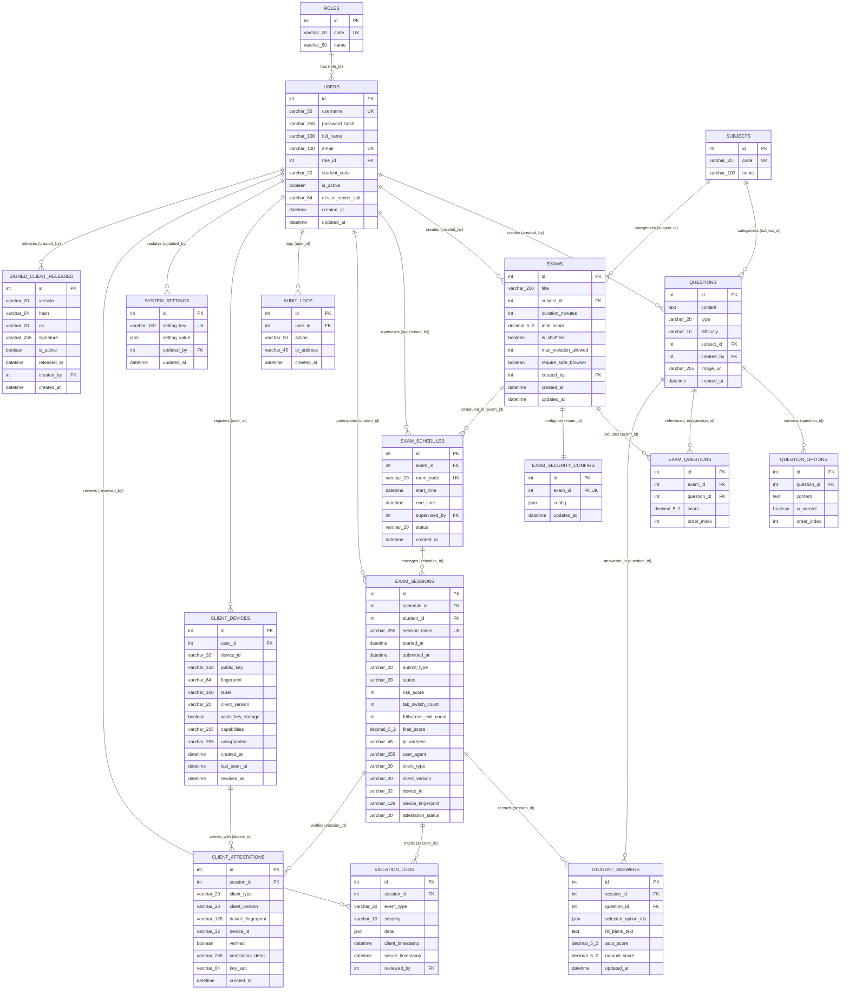

# SƠ ĐỒ THỰC THỂ LIÊN KẾT (ENTITY RELATIONSHIP DIAGRAM - ERD)
## Hệ thống Thi trắc nghiệm trực tuyến An toàn (Secure Online Exam System)

> **Mục đích tài liệu:** Cung cấp bức tranh toàn cảnh về thiết kế cơ sở dữ liệu quan hệ (RDBMS - MySQL) của hệ thống, bao gồm đầy đủ 16 bảng đang hoạt động trong backend và bảng dự kiến quản lý phiên bản ký số (`signed_client_releases`).
>
> Đối chiếu trực tiếp với SQLAlchemy ORM models tại `backend/app/models/` và các migration Alembic tại `backend/alembic/versions/`.

---

## 1. Sơ đồ Mermaid ERD tổng quan

---

## 2. Bản đồ phân nhóm dữ liệu

17 bảng trong hệ thống được chia làm 5 phân hệ logic:

1. **Phân hệ Người dùng & Phân quyền (Auth & Identity):** `roles`, `users`, `audit_logs`
2. **Phân hệ Ngân hàng câu hỏi (Item Bank):** `subjects`, `questions`, `question_options`
3. **Phân hệ Đề thi & Lịch thi (Exam Authoring & Scheduling):** `exams`, `exam_questions`, `exam_security_configs`, `exam_schedules`
4. **Phân hệ Phiên làm bài & Giám sát (Exam Execution & Monitoring):** `exam_sessions`, `student_answers`, `violation_logs`
5. **Phân hệ Xác thực Client & Cấu hình bảo mật (Attestation & Integrity):** `system_settings`, `client_devices`, `client_attestations`, `signed_client_releases` (Phase 2)

---

## 3. Từ điển dữ liệu chi tiết từng bảng (Data Dictionary)

### 3.1. Phân hệ Người dùng & Phân quyền

#### Bảng `roles`
*Định nghĩa các vai trò trong hệ thống.*

| Tên cột | Kiểu dữ liệu | Ràng buộc | Mô tả |
|---|---|---|---|
| `id` | `INT` | PK, Auto Increment | Mã định danh vai trò |
| `code` | `VARCHAR(20)` | Unique, Not Null, Index | Mã vai trò: `ADMIN`, `TEACHER`, `STUDENT` |
| `name` | `VARCHAR(50)` | Not Null | Tên hiển thị (Quản trị viên, Giảng viên, Thí sinh) |

#### Bảng `users`
*Tài khoản người dùng (quản trị viên, giảng viên, sinh viên).*

| Tên cột | Kiểu dữ liệu | Ràng buộc | Mô tả |
|---|---|---|---|
| `id` | `INT` | PK, Auto Increment | Mã người dùng |
| `username` | `VARCHAR(50)` | Unique, Not Null, Index | Tên đăng nhập |
| `password_hash` | `VARCHAR(255)` | Not Null | Hash mật khẩu (bcrypt) |
| `full_name` | `VARCHAR(100)` | Not Null | Họ và tên |
| `email` | `VARCHAR(100)` | Unique, Not Null, Index | Địa chỉ email |
| `role_id` | `INT` | FK -> `roles.id`, Restrict, Not Null | Vai trò người dùng |
| `student_code` | `VARCHAR(20)` | Nullable, Index | Mã sinh viên (dành riêng cho vai trò `STUDENT`) |
| `is_active` | `BOOLEAN` | Not Null, Default `TRUE` | Trạng thái hoạt động (`FALSE`: bị khóa) |
| `device_secret_salt` | `VARCHAR(64)` | Nullable | Chuỗi salt ngẫu nhiên dùng dẫn xuất `device_secret` (Phase 0 HMAC) |
| `created_at` | `DATETIME` | Not Null | Thời điểm tạo tài khoản (UTC) |
| `updated_at` | `DATETIME` | Not Null | Thời điểm cập nhật cuối (UTC) |

#### Bảng `audit_logs`
*Lưu vết các thao tác quản trị và thay đổi cấu hình hệ thống.*

| Tên cột | Kiểu dữ liệu | Ràng buộc | Mô tả |
|---|---|---|---|
| `id` | `INT` | PK, Auto Increment | Mã bản ghi log |
| `user_id` | `INT` | FK -> `users.id`, Set Null, Nullable | Người thực hiện thao tác |
| `action` | `VARCHAR(50)` | Not Null | Tên hành động (VD: `LOGIN`, `UPDATE_SETTING`, `LOCK_USER`) |
| `ip_address` | `VARCHAR(45)` | Nullable | Địa chỉ IP của client gọi yêu cầu (hỗ trợ IPv4/IPv6) |
| `created_at` | `DATETIME` | Not Null | Thời điểm ghi log (UTC) |

---

### 3.2. Phân hệ Ngân hàng câu hỏi

#### Bảng `subjects`
*Quản lý môn học / học phần.*

| Tên cột | Kiểu dữ liệu | Ràng buộc | Mô tả |
|---|---|---|---|
| `id` | `INT` | PK, Auto Increment | Mã môn học |
| `code` | `VARCHAR(20)` | Unique, Not Null, Index | Mã định danh môn (VD: `CS101`, `PBL4`) |
| `name` | `VARCHAR(100)` | Not Null | Tên môn học |

#### Bảng `questions`
*Ngân hàng câu hỏi trắc nghiệm.*

| Tên cột | Kiểu dữ liệu | Ràng buộc | Mô tả |
|---|---|---|---|
| `id` | `INT` | PK, Auto Increment | Mã câu hỏi |
| `content` | `TEXT` | Not Null | Nội dung câu hỏi (hỗ trợ văn bản thuần hoặc HTML) |
| `type` | `VARCHAR(20)` | Not Null | Loại câu: `SINGLE_CHOICE`, `MULTI_CHOICE`, `FILL_BLANK` |
| `difficulty` | `VARCHAR(10)` | Not Null, Default `MEDIUM` | Mức độ: `EASY`, `MEDIUM`, `HARD` |
| `subject_id` | `INT` | FK -> `subjects.id`, Cascade, Not Null, Index | Thuộc môn học nào |
| `created_by` | `INT` | FK -> `users.id`, Set Null, Nullable | Giảng viên tạo câu hỏi |
| `image_url` | `VARCHAR(255)` | Nullable | Đường dẫn ảnh minh họa đính kèm |
| `created_at` | `DATETIME` | Not Null | Thời điểm tạo câu hỏi (UTC) |

#### Bảng `question_options`
*Lựa chọn đáp án cho các câu hỏi trắc nghiệm.*

| Tên cột | Kiểu dữ liệu | Ràng buộc | Mô tả |
|---|---|---|---|
| `id` | `INT` | PK, Auto Increment | Mã phương án lựa chọn |
| `question_id` | `INT` | FK -> `questions.id`, Cascade, Not Null, Index | Thuộc câu hỏi nào |
| `content` | `TEXT` | Not Null | Nội dung đáp án lựa chọn |
| `is_correct` | `BOOLEAN` | Not Null, Default `FALSE` | Đánh dấu đáp án đúng (**BẢO MẬT: Không bao giờ trả về client khi làm bài**) |
| `order_index` | `INT` | Not Null, Default `0` | Thứ tự hiển thị phương án |

---

### 3.3. Phân hệ Đề thi & Lịch thi

#### Bảng `exams`
*Thông tin đề thi.*

| Tên cột | Kiểu dữ liệu | Ràng buộc | Mô tả |
|---|---|---|---|
| `id` | `INT` | PK, Auto Increment | Mã đề thi |
| `title` | `VARCHAR(200)` | Not Null | Tiêu đề đề thi |
| `subject_id` | `INT` | FK -> `subjects.id`, Cascade, Not Null, Index | Thuộc môn học nào |
| `duration_minutes` | `INT` | Not Null, Default `60` | Thời gian làm bài (phút) |
| `total_score` | `NUMERIC(5, 2)` | Not Null, Default `10.00` | Tổng điểm tối đa của đề thi |
| `is_shuffled` | `BOOLEAN` | Not Null, Default `TRUE` | Cho phép xáo trộn thứ tự câu hỏi và phương án |
| `max_violation_allowed` | `INT` | Not Null, Default `5` | Ngưỡng vi phạm tối đa (bậc 2 fallback cho `anticheat_service`) |
| `require_safe_browser` | `BOOLEAN` | Not Null, Default `FALSE` | Cờ cấp đề: Bắt buộc thí sinh phải dùng SEB Client đã xác thực |
| `created_by` | `INT` | FK -> `users.id`, Set Null, Nullable | Giảng viên tạo đề |
| `created_at` | `DATETIME` | Not Null | Thời điểm tạo đề (UTC) |
| `updated_at` | `DATETIME` | Not Null | Thời điểm cập nhật đề (UTC) |

#### Bảng `exam_questions`
*Bảng nối N-N giữa đề thi và câu hỏi.*

| Tên cột | Kiểu dữ liệu | Ràng buộc | Mô tả |
|---|---|---|---|
| `id` | `INT` | PK, Auto Increment | Mã liên kết |
| `exam_id` | `INT` | FK -> `exams.id`, Cascade, Not Null, Index | Thuộc đề thi nào |
| `question_id` | `INT` | FK -> `questions.id`, Cascade, Not Null, Index | Câu hỏi được chọn |
| `score` | `NUMERIC(5, 2)` | Not Null, Default `1.00` | Điểm số của câu hỏi trong đề này |
| `order_index` | `INT` | Not Null, Default `0` | Thứ tự câu hỏi trong đề thi |

#### Bảng `exam_security_configs`
*Cấu hình bảo mật chi tiết cấp đề thi (Quan hệ 1-1 với `exams`).*

| Tên cột | Kiểu dữ liệu | Ràng buộc | Mô tả |
|---|---|---|---|
| `id` | `INT` | PK, Auto Increment | Mã cấu hình |
| `exam_id` | `INT` | FK -> `exams.id`, Cascade, Not Null, Unique, Index | Thuộc đề thi nào (1 đề thi có duy nhất 1 cấu hình) |
| `config` | `JSON` | Not Null | Cấu hình chi tiết Pydantic: `require_fullscreen`, `block_copy_paste`, `block_devtools`, `detect_devtools`, `monitor_tab_switch`, `lock_navigation`, `max_tab_switch`, `max_fullscreen_exit`, `auto_submit_on_threshold`, `warn_countdown_seconds`, `disable_print`, `allow_web_fallback` |
| `updated_at` | `DATETIME` | Not Null | Thời điểm cập nhật cuối (UTC) |

#### Bảng `exam_schedules`
*Ca thi cụ thể gắn với một đề thi.*

| Tên cột | Kiểu dữ liệu | Ràng buộc | Mô tả |
|---|---|---|---|
| `id` | `INT` | PK, Auto Increment | Mã ca thi |
| `exam_id` | `INT` | FK -> `exams.id`, Cascade, Not Null, Index | Đề thi được sử dụng |
| `room_code` | `VARCHAR(20)` | Unique, Not Null, Index | Mã phòng thi (thí sinh nhập chuỗi này để vào phòng, VD: `PBL4-EXAM-01`) |
| `start_time` | `DATETIME` | Not Null | Thời điểm bắt đầu ca thi (UTC) |
| `end_time` | `DATETIME` | Not Null | Thời điểm kết thúc ca thi (UTC) |
| `supervised_by` | `INT` | FK -> `users.id`, Set Null, Nullable | Giám thị / giảng viên coi ca thi |
| `status` | `VARCHAR(20)` | Not Null, Default `SCHEDULED` | Trạng thái ca: `SCHEDULED`, `ONGOING`, `FINISHED`, `CANCELLED` |
| `created_at` | `DATETIME` | Not Null | Thời điểm tạo ca thi (UTC) |

---

### 3.4. Phân hệ Phiên làm bài & Giám sát

#### Bảng `exam_sessions`
*Phiên làm bài của một thí sinh trong một ca thi.*

| Tên cột | Kiểu dữ liệu | Ràng buộc | Mô tả |
|---|---|---|---|
| `id` | `INT` | PK, Auto Increment | Mã phiên thi |
| `schedule_id` | `INT` | FK -> `exam_schedules.id`, Cascade, Not Null, Index | Thuộc ca thi nào |
| `student_id` | `INT` | FK -> `users.id`, Cascade, Not Null, Index | Thí sinh tham gia |
| `session_token` | `VARCHAR(255)` | Unique, Not Null, Index | Token định danh phiên (`sess_<uuid4>`), dùng cho Socket.IO và API nộp bài |
| `started_at` | `DATETIME` | Not Null | Thời điểm bắt đầu phiên (UTC) |
| `submitted_at` | `DATETIME` | Nullable | Thời điểm nộp bài (UTC) |
| `submit_type` | `VARCHAR(20)` | Nullable | Hình thức nộp: `MANUAL`, `SHUTDOWN_BUTTON`, `AUTO_TIMEOUT`, `AUTO_VIOLATION` |
| `status` | `VARCHAR(20)` | Not Null, Default `IN_PROGRESS` | Trạng thái phiên: `IN_PROGRESS`, `SUBMITTED`, `DISCONNECTED` |
| `risk_score` | `INT` | Not Null, Default `0` | Điểm rủi ro tích lũy (0-1000) phục vụ cảnh báo |
| `tab_switch_count` | `INT` | Not Null, Default `0` | Số lần chuyển tab hoặc mất tiêu điểm |
| `fullscreen_exit_count` | `INT` | Not Null, Default `0` | Số lần thoát toàn màn hình |
| `final_score` | `NUMERIC(5, 2)` | Nullable | Điểm số cuối cùng sau khi chấm điểm tự động |
| `ip_address` | `VARCHAR(45)` | Nullable | IP của thí sinh khi bắt đầu phiên |
| `user_agent` | `VARCHAR(255)` | Nullable | Chuỗi User-Agent của client |
| `client_type` | `VARCHAR(20)` | Not Null, Default `web` | Loại client: `web` hoặc `seb` |
| `client_version` | `VARCHAR(20)` | Nullable | Phiên bản của client đang chạy |
| `device_id` | `VARCHAR(32)` | Nullable, Index | Định danh thiết bị Ed25519 (`sha256(pubkey)[:16]`) |
| `device_fingerprint` | `VARCHAR(128)` | Nullable | Vân tay thiết bị gắn với attestation token |
| `attestation_status` | `VARCHAR(20)` | Not Null, Default `NOT_ATTESTED` | Trạng thái xác thực client: `NOT_ATTESTED`, `VERIFIED`, `FAILED`, `REQUIRED_MISSING` |

> **Ràng buộc duy nhất (Unique Constraint):** `UNIQUE(schedule_id, student_id)` — Đảm bảo mỗi thí sinh chỉ có tối đa 1 phiên trong 1 ca thi.

#### Bảng `student_answers`
*Đáp án từng câu hỏi do thí sinh nộp trong phiên làm bài.*

| Tên cột | Kiểu dữ liệu | Ràng buộc | Mô tả |
|---|---|---|---|
| `id` | `INT` | PK, Auto Increment | Mã bản ghi câu trả lời |
| `session_id` | `INT` | FK -> `exam_sessions.id`, Cascade, Not Null, Index | Thuộc phiên làm bài nào |
| `question_id` | `INT` | FK -> `questions.id`, Cascade, Not Null, Index | Thuộc câu hỏi nào |
| `selected_option_ids` | `JSON` | Nullable | Danh sách ID các lựa chọn được chọn (VD: `[1, 3]`) |
| `fill_blank_text` | `TEXT` | Nullable | Nội dung trả lời câu hỏi điền từ |
| `auto_score` | `NUMERIC(5, 2)` | Nullable | Điểm server tự động chấm dựa trên đáp án đúng |
| `manual_score` | `NUMERIC(5, 2)` | Nullable | Điểm giảng viên chấm thủ công (nếu có phúc tra) |
| `updated_at` | `DATETIME` | Not Null | Thời điểm cập nhật đáp án gần nhất (UTC) |

> **Ràng buộc duy nhất (Unique Constraint):** `UNIQUE(session_id, question_id)` — Mỗi câu hỏi chỉ có 1 bản ghi câu trả lời duy nhất trong phiên thi.

#### Bảng `violation_logs`
*Nhật ký ghi nhận các hành vi vi phạm kỷ luật phòng thi.*

| Tên cột | Kiểu dữ liệu | Ràng buộc | Mô tả |
|---|---|---|---|
| `id` | `INT` | PK, Auto Increment | Mã sự kiện vi phạm |
| `session_id` | `INT` | FK -> `exam_sessions.id`, Cascade, Not Null, Index | Thuộc phiên thi nào |
| `event_type` | `VARCHAR(30)` | Not Null | Loại vi phạm: `TAB_SWITCH`, `FULLSCREEN_EXIT`, `DEVTOOLS_DETECTED`, `COPY_PASTE_ATTEMPT`, `RIGHT_CLICK_ATTEMPT`, `DUPLICATE_LOGIN`, `CONNECTION_LOST`, `UNAUTHORIZED_CLIENT`, ... |
| `severity` | `VARCHAR(10)` | Not Null, Default `MEDIUM` | Mức độ nghiêm trọng: `LOW`, `MEDIUM`, `HIGH` |
| `detail` | `JSON` | Nullable | Chi tiết bổ sung (tên cửa sổ chiếm tiêu điểm, thông số màn hình, thời gian lệch...) |
| `client_timestamp` | `DATETIME` | Not Null | Thời điểm xảy ra theo đồng hồ client |
| `server_timestamp` | `DATETIME` | Not Null | Thời điểm server nhận được và ghi log (UTC, **nguồn sự thật**) |
| `reviewed_by` | `INT` | FK -> `users.id`, Set Null, Nullable | Giảng viên/giám thị đã xem xét vi phạm này |

> **Chỉ mục (Index):** `Index("idx_session_client_time", "session_id", "client_timestamp")` hỗ trợ tra cứu tiến trình vi phạm nhanh theo thời gian.

---

### 3.5. Phân hệ Xác thực Client & Cấu hình bảo mật

#### Bảng `system_settings`
*Cấu hình toàn cục toàn hệ thống (dạng key-value JSON).*

| Tên cột | Kiểu dữ liệu | Ràng buộc | Mô tả |
|---|---|---|---|
| `id` | `INT` | PK, Auto Increment | Mã cấu hình |
| `setting_key` | `VARCHAR(100)` | Unique, Not Null, Index | Tên khóa cấu hình (VD: `require_safe_browser_global`, `seb_client_config`) |
| `setting_value` | `JSON` | Not Null | Giá trị cấu hình dạng JSON |
| `updated_by` | `INT` | FK -> `users.id`, Set Null, Nullable | Quản trị viên cập nhật |
| `updated_at` | `DATETIME` | Not Null | Thời điểm cập nhật cuối (UTC) |

#### Bảng `client_devices`
*Quản lý khoá công khai Ed25519 của thiết bị SEB Client đã đăng ký.*

| Tên cột | Kiểu dữ liệu | Ràng buộc | Mô tả |
|---|---|---|---|
| `id` | `INT` | PK, Auto Increment | Mã thiết bị trong CSDL |
| `user_id` | `INT` | FK -> `users.id`, Cascade, Not Null, Index | Thí sinh sở hữu thiết bị |
| `device_id` | `VARCHAR(32)` | Not Null, Index | Mã định danh thiết bị: `sha256(public_key)[:16]` |
| `public_key` | `VARCHAR(128)` | Not Null | Khóa công khai Ed25519 (base64 raw 32 bytes) |
| `fingerprint` | `VARCHAR(64)` | Not Null | SHA-256 fingerprint của khóa công khai |
| `label` | `VARCHAR(100)` | Nullable | Nhãn mô tả thiết bị (VD: `Laptop Dell Win11`) |
| `client_version` | `VARCHAR(20)` | Nullable | Phiên bản SEB Client khi đăng ký |
| `weak_key_storage` | `BOOLEAN` | Not Null, Default `FALSE` | Đánh dấu môi trường không có Keystore an toàn (VD: Linux không có Secret Service) |
| `capabilities` | `VARCHAR(255)` | Nullable | Danh sách cơ chế bảo mật OS hỗ trợ (VD: `kiosk,monitor_switch,clipboard`) |
| `unsupported` | `VARCHAR(255)` | Nullable | Danh sách tính năng OS không hỗ trợ (VD: `Wayland:no_foreground_window`) |
| `created_at` | `DATETIME` | Not Null | Thời điểm đăng ký thiết bị (UTC) |
| `last_seen_at` | `DATETIME` | Nullable | Lần cuối thiết bị thực hiện attestation thành công |
| `revoked_at` | `DATETIME` | Nullable | Thời điểm thu hồi khóa thiết bị (nếu bị thu hồi) |

> **Ràng buộc duy nhất:** `UNIQUE(user_id, device_id)`
> **Chỉ mục:** `Index("idx_client_device_fingerprint", "fingerprint")`

#### Bảng `client_attestations`
*Lưu vết kết quả xác thực challenge-response của SEB Client cho từng phiên thi.*

| Tên cột | Kiểu dữ liệu | Ràng buộc | Mô tả |
|---|---|---|---|
| `id` | `INT` | PK, Auto Increment | Mã bản ghi attestation |
| `session_id` | `INT` | FK -> `exam_sessions.id`, Cascade, Not Null, Index | Thuộc phiên thi nào |
| `client_type` | `VARCHAR(20)` | Not Null | Loại client: `web` hoặc `seb` |
| `client_version` | `VARCHAR(20)` | Nullable | Phiên bản client khai báo |
| `device_fingerprint` | `VARCHAR(128)` | Nullable | Vân tay thiết bị gắn với phiên thi |
| `device_id` | `VARCHAR(32)` | Nullable | Khóa công khai Ed25519 đã xác thực (`device_id`) |
| `verified` | `BOOLEAN` | Not Null, Default `FALSE` | Kết quả xác thực chữ ký (`TRUE` nếu thành công) |
| `verification_detail` | `VARCHAR(255)` | Nullable | Lý do lỗi nếu thất bại (VD: `NONCE_INVALID_OR_EXPIRED`, `SIGNATURE_MISMATCH`) |
| `key_salt` | `VARCHAR(64)` | Nullable | Salt dùng dẫn xuất lại khóa phiên để xác thực heartbeat |
| `created_at` | `DATETIME` | Not Null | Thời điểm xác thực (UTC) |

> **Chỉ mục:**
> - `Index("idx_attestation_session", "session_id", "verified")`
> - `Index("idx_attestation_device", "device_id", "verified")`

#### Bảng `signed_client_releases` *(Dự kiến mở rộng Phase 2 — Quản lý bản phát hành đã ký số)*
*Lưu danh sách hash nhị phân của các bản build SEB Client chính thức đã được ký số.*

| Tên cột | Kiểu dữ liệu | Ràng buộc | Mô tả |
|---|---|---|---|
| `id` | `INT` | PK, Auto Increment | Mã bản phát hành |
| `version` | `VARCHAR(20)` | Not Null | Phiên bản client (VD: `1.0.0`, `1.1.0`) |
| `hash` | `VARCHAR(64)` | Not Null, Index | SHA-256 hash của binary đóng gói chính thức |
| `os` | `VARCHAR(20)` | Not Null | Hệ điều hành: `windows`, `macos`, `linux` |
| `signature` | `VARCHAR(255)` | Nullable | Thông tin chữ ký số (Authenticode / Codesign notarization) |
| `is_active` | `BOOLEAN` | Not Null, Default `TRUE` | Trạng thái cho phép sử dụng bản build này |
| `released_at` | `DATETIME` | Not Null | Ngày phát hành chính thức |
| `created_by` | `INT` | FK -> `users.id`, Set Null, Nullable | Quản trị viên/GV đưa bản build lên whitelist |
| `created_at` | `DATETIME` | Not Null | Thời điểm tạo bản ghi (UTC) |

---

## 4. Bảng tổng hợp quan hệ (Cardinality & Cascade Rules)

| Bảng cha (1) | Bảng con (N) | Khóa ngoại | Hành vi ON DELETE | Ý nghĩa nghiệp vụ |
|---|---|---|---|---|
| `roles` | `users` | `role_id` | `RESTRICT` | Không được xóa vai trò khi còn tài khoản người dùng mang vai trò đó |
| `users` | `questions` | `created_by` | `SET NULL` | Giảng viên nghỉ dạy thì câu hỏi vẫn được giữ lại trong ngân hàng |
| `users` | `exams` | `created_by` | `SET NULL` | Giảng viên nghỉ dạy thì đề thi vẫn giữ lại |
| `users` | `exam_schedules` | `supervised_by` | `SET NULL` | Giám thị thay đổi thì ca thi vẫn được giữ |
| `users` | `exam_sessions` | `student_id` | `CASCADE` | Xóa tài khoản sinh viên sẽ xóa sạch các phiên thi liên quan |
| `users` | `audit_logs` | `user_id` | `SET NULL` | Giữ nguyên vết audit log kể cả khi tài khoản bị xóa |
| `users` | `client_devices` | `user_id` | `CASCADE` | Xóa sinh viên thì thu hồi toàn bộ thiết bị đã đăng ký |
| `users` | `system_settings` | `updated_by` | `SET NULL` | Giữ nguyên cấu hình hệ thống khi người sửa bị xóa |
| `users` | `violation_logs` | `reviewed_by` | `SET NULL` | Giữ nguyên nhật ký vi phạm |
| `users` | `signed_client_releases`| `created_by` | `SET NULL` | Giữ nguyên danh sách hash bản build |
| `subjects` | `questions` | `subject_id` | `CASCADE` | Xóa môn học sẽ xóa toàn bộ câu hỏi thuộc môn đó |
| `subjects` | `exams` | `subject_id` | `CASCADE` | Xóa môn học sẽ xóa toàn bộ đề thi của môn đó |
| `questions` | `question_options`| `question_id` | `CASCADE` | Xóa câu hỏi sẽ xóa toàn bộ các lựa chọn |
| `questions` | `exam_questions` | `question_id` | `CASCADE` | Xóa câu hỏi khỏi ngân hàng sẽ gỡ khỏi các đề thi |
| `questions` | `student_answers`| `question_id` | `CASCADE` | Xóa câu hỏi sẽ xóa đáp án tương ứng của sinh viên |
| `exams` | `exam_questions` | `exam_id` | `CASCADE` | Xóa đề thi sẽ xóa cấu trúc đề |
| `exams` | `exam_security_configs` | `exam_id` | `CASCADE` | Xóa đề thi sẽ xóa cấu hình bảo mật đi kèm (1-1) |
| `exams` | `exam_schedules` | `exam_id` | `CASCADE` | Xóa đề thi sẽ hủy bỏ toàn bộ ca thi dùng đề này |
| `exam_schedules` | `exam_sessions` | `schedule_id` | `CASCADE` | Hủy ca thi sẽ xóa toàn bộ phiên thi của ca |
| `exam_sessions` | `student_answers`| `session_id` | `CASCADE` | Xóa phiên thi sẽ xóa toàn bộ bài làm của thí sinh |
| `exam_sessions` | `violation_logs` | `session_id` | `CASCADE` | Xóa phiên thi sẽ xóa lịch sử vi phạm |
| `exam_sessions` | `client_attestations` | `session_id` | `CASCADE` | Xóa phiên thi sẽ xóa bằng chứng attestation |
